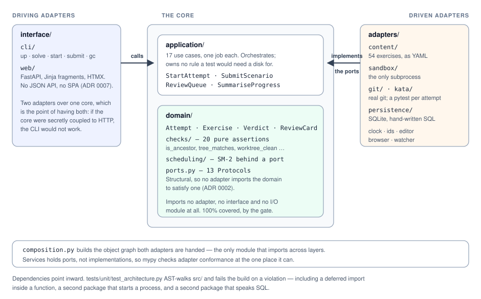

# swe-practice

An offline practice environment for the two things entry-level engineers are
actually tested on: **data-structure problem solving** and **operational
competence with git**. It is a local web app with a terminal beside it — no
network, no accounts, no CDN.

The core bet, in one line:

> **Grade the end state, not the answer text.**

A git exercise ships a fixture that builds a real repository with a real problem
in it — a detached HEAD, a bad merge, a commit already pushed to a shared branch.
You run real git commands against it, and grading inspects the resulting
repository against declarative assertions. So `git revert`, `git reset --hard`
and `git checkout <sha> -- .` are judged on what they actually did, *including
how they differ*.


That is the whole argument in one verdict. The **content check passes** — the
files are byte-identical to what a correct `git revert` produces — and the
ancestry check is what tells the two apart. A tool grading on file content
accepts this answer; a tool matching command text would have to guess which of
two dozen correct phrasings to allow.

The demo is generated rather than recorded: `docs/demo/session.txt` is the
captured output of that command and `docs/demo/render.py` draws it
([ADR 0016](docs/adr/0016-a-generated-demo-not-a-recorded-one.md)).

## Contents

- [What is in it](#what-is-in-it)
- [Getting started](#getting-started)
- [The web app](#the-web-app)
- [The terminal](#the-terminal)
- [What to practise today](#what-to-practise-today)
- [Interview conditions](#interview-conditions)
- [Asking an AI about the one you are stuck on](#asking-an-ai-about-the-one-you-are-stuck-on)
- [The exercise library](#the-exercise-library)
- [Security model](#security-model)
- [Architecture](#architecture)
- [Development](#development)
- [Further reading](#further-reading)
- [License](#license)

## What is in it

- **115 exercises, every one of them graded**: 24 git scenarios, 83 Python
  katas and 8 SQL drills, in twenty-one hand-ordered tracks.
- **A web workbench**: an editor for katas and drills, and for git scenarios a
  command console over the real repository with a live commit graph beside it.
- **A terminal that is not a fallback**: the CLI is a second adapter over the
  same use cases, so an attempt started in the browser can be finished from a
  shell.
- **Your own editor**: a kata is a real file on disk, re-graded every time you
  save it.
- **Spaced repetition** that answers *what should I practise today?* — SM-2 by
  default, FSRS behind the same port.
- **Interview mode**: no hints, a clock, and no path to the workspace.
- **A tutor you bring yourself**: one button turns the attempt you are stuck on
  into text for an AI chat, or a read-only MCP server lets the client fetch it.
  It holds what you have seen and none of what you have not.
- **Content packs**: the whole library as one verifiable file you can send
  somebody.

This is v1.0.0 plus seven post-v1 additions.
[docs/PLAN.md](docs/PLAN.md) is the full design and the phase-by-phase record of
how it was built; [docs/adr/](docs/adr/) holds the twenty-four decisions with
the alternatives that were rejected, which is usually the half worth reading.

## Getting started

Requires [uv](https://docs.astral.sh/uv/), Python 3.13 and git. On Windows that
means Git for Windows, whose bundled bash is what runs the fixtures. Nothing
else — no npm, no bundler, no network.

```bash
uv sync
uv run practice up
```

`up` is the front door. It resolves git, counts the library, creates the
workspace directory, migrates the database, names the scheduler, and then opens
your browser on `http://127.0.0.1:8765`:

```
  ok   git         /usr/bin/git
  ok   library     115 exercises (24 git scenarios, 83 katas, 8 SQL drills) in ~/swe-practice/content
  ok   workspaces  ~/.cache/swe-practice/ws
  ok   database    ~/.local/share/swe-practice/practice.db (created v2)
  ok   scheduler   sm2 (Sm2Scheduler())

First run: your attempt history now lives at ~/.local/share/swe-practice/practice.db.

http://127.0.0.1:8765
```

It **refuses** rather than serving degraded, and it reports every problem in one
pass rather than one per run: with no git there is no fixture, with no library
there is nothing to offer, with no database an attempt cannot be saved
([ADR 0017](docs/adr/0017-a-front-door-separate-from-the-server.md)).

From there: see what is due, start an attempt, write a solution in the editor or
type real git into a console, read the verdict, and schedule the next sighting.
Everything it serves comes off the disk, so it works with the wifi off.

`practice serve` is the same server without the setup, and
`practice up --no-open` is for a machine with no browser on it.

## The web app

`/` is the dashboard — what is due, your streak, your weakest tags. `/browse`
filters the library by kind, difficulty and tag, and starts an attempt;
`/attempt/{id}` is the workbench; `/progress` is the long form.

For a kata the workbench is the prompt beside a CodeMirror editor seeded from
the exercise's stub. For a git scenario it is a **command console over the real
repository**, with a repo state panel and a commit graph beside it. An attempt
already open shows **Resume** instead of **Start**, because a second one would
split one piece of work across two budgets.

Submissions return **HTML, not JSON**. There is no JSON API, and the fragment a
submission renders is the same template the page uses when it loads an attempt
that was graded last week, so a reload cannot disagree with what you were just
shown ([ADR 0007](docs/adr/0007-htmx-over-a-single-page-app.md)).

**Offline is enforced, not promised.** htmx and CodeMirror 5 are committed files
pinned by SHA-256. One test greps every template and stylesheet of ours for a
remote reference, a second checks the five vendored files against their hashes,
and a third asserts that every file under `static/` is covered by one of the
two. CodeMirror **5** and not 6 is a real tradeoff, recorded in
[ADR 0010](docs/adr/0010-codemirror-5-over-6.md): a maintenance-mode dependency,
accepted to keep an npm toolchain out of a Python project for one widget.

### The scenario workbench

Type `git revert --no-edit HEAD` into the console and three things come back in
one response: the command's output appended to the transcript, the command
budget, and the whole repo state panel — HEAD and whether it is detached, the
local branches, what `origin/main` points at, the four worktree states, the
stash, and a hand-rolled SVG commit graph. htmx swaps the first in place and the
rest by id, so there is no client-side model of a repository anywhere.

The thing to watch is `git reset --hard HEAD~1`. `main` moves down a commit, the
commit it left behind stays on the graph because `origin/main` still points at
it, and the two lines of the panel say what you just did to your teammate before
the verdict does.

**The panel reads the repository through the same port the grader does**
([ADR 0012](docs/adr/0012-inspect-the-repository-through-the-grading-port.md)).
A display-only git wrapper would have been less code and would have let the
panel and the verdict quietly disagree.

Hints are revealed one at a time, and each reveal is recorded on the attempt
alongside the commands — "passed, with three of four hints" is a different
outcome from "passed", and that is the record the scheduler reads.

### Your own editor

A textarea is not where anyone wants to write a hash map. **Open in my editor**
starts your editor on the file the kata is actually graded from, and from then
on the browser re-grades it every time you save:

```
YOUR EDITOR
The solution for this attempt is a real file. Edit and save it in whatever you
like:

  C:\Users\you\AppData\Local\swe-practice\ws\18ec95b0\repo\stub.py

Opened in your editor. Watching for saves. Re-graded every time you save.
```

Which editor is one environment variable, `PRACTICE_EDITOR`, defaulting to
`code`. `$EDITOR` is deliberately *not* consulted: it names a program that
expects to own a terminal, and this launch has none. If the editor cannot be
started the panel says so **and still shows the path**, because the feature is
the file and the launch is the convenience on top of it. `practice start` prints
the same path, so the terminal has own-editor mode too.

**A save is a preview, never a submission**
([ADR 0013](docs/adr/0013-grade-on-save-is-a-preview.md)). A save grades the
file's contents in memory and throws the result away; nothing is written to the
attempt's log. Submitting is still a button, and it is still the only thing that
writes. The verdict arrives over server-sent events as the same HTML fragment a
submission returns, and the browser editor goes read-only and mirrors what is on
disk — so with two editors open, Submit sends the source the verdict on screen
was computed from.

## The terminal

### Solving a kata

```bash
uv run practice solve katas/two-sum --source my-solution.py --time "O(n)" --space "O(n)"
```

Each test in the hidden suite becomes one check, labelled with its docstring, so
a failure reads as a sentence about what the solution must do rather than as a
function name. The declared complexity is **compared and never graded** — static
Big-O analysis of arbitrary code is not something this tool pretends to do — so
a claim that disagrees with the exercise's expectation is an *advisory*: you
passed, and here is the thing to reconcile.

With no `--source` it grades the exercise's own stub, which fails every check.
That is the intended first run: a hidden suite that passes an unimplemented stub
grades nothing, and the content suite holds every kata in the library to both
halves of that.

It exits 0 on a pass (advisories included), 1 when a required check fails, and 2
when the attempt could not be run at all.

### Solving a git scenario

```bash
uv run practice solve git/revert-a-pushed-commit --commands my-attempt.cmds
```

A `.cmds` file is one command per line, `#` comments and blanks ignored — the
same format the library's own reference solutions use. Every line goes through
the real command policy: parsed into an argv, checked against the exercise's
`allowed_commands`, and run with **no shell**, so `echo x > f` is refused with a
pointer to the virtual `write` instead of silently not redirecting.

```bash
uv run practice solve git/revert-a-pushed-commit --reference
```

Replays the exercise's own solution, which is exactly how CI grades it — through
the same use cases, the same policy and the same budget a solver gets. If a
reference answer were validated against different rules, a green build would
mean a solution exists rather than a solution exists *within the rules*
([ADR 0011](docs/adr/0011-reference-solutions-are-command-lists.md)).

A `.cmds` file is not a REPL. The interactive console is in the web workbench,
where a commit graph can actually be drawn. Both drive the same attempt, the
same log and the same budget.

### Working on an attempt

An attempt outlives the process that started it, so it can be opened, worked on
and graded by different invocations:

```bash
uv run practice start git/revert-a-pushed-commit
uv run practice resume <id> --commands look-around.cmds
uv run practice resume <id> --commands the-fix.cmds
uv run practice submit <id>
```

Four processes, one repository, one event log and one budget — ten commands
yesterday and five today is fifteen of twenty-five.

```bash
uv run practice attempts
uv run practice attempts --exercise git/revert-a-pushed-commit
uv run practice abandon <id>
```

`attempts` lists what is still open, oldest first, and says of each whether it
**can** be resumed — one whose workspace has been collected cannot, and the only
thing left is to abandon it. An interrupted session is neither silently lost nor
silently resurrected. Abandoning deletes the workspace and keeps the attempt,
marked, with its whole log.

Attempts and review cards live in one SQLite file under the user *data*
directory, not the cache — a workspace is rebuildable from a fixture and a
history is not ([ADR 0006](docs/adr/0006-sqlite-without-an-orm.md)).

## What to practise today

Under the verdict is a schedule control, and it is what turns a pile of graded
attempts into a training system. The tool **suggests** the grade, because it has
three readings you do not: the verdict it derived from the end state, the hints
you revealed, and the time against the author's own estimate. A clean pass
inside the estimate with no hints is `easy`; each of the three costs a step; a
failure is `again`, and a *pass* never is.

```
SCHEDULE
Suggested: good — passed, but 1 hint revealed
  [ again ]  [ hard ]  [ good ★ ]  [ easy ]
```

Nothing is scheduled until a button is pressed, so the suggestion can always be
overridden, and one attempt moves a card exactly once.

The scheduler is SM-2 by default — the four-grade Anki variant, as a pure
function with no clock and no repository. **FSRS is the second implementation,
and `PRACTICE_SCHEDULER=fsrs` is the whole of switching to it.** A card SM-2
left at fifteen days is adopted by FSRS rather than reset. SM-2 stays the
default for an honest reason: FSRS's advantage comes from parameters fitted to a
log of your own reviews, this tool keeps one row per exercise and no log, and
FSRS on unfitted defaults is FSRS without the thing that makes it better
([ADR 0008](docs/adr/0008-sm2-first-with-fsrs-behind-a-port.md),
[ADR 0018](docs/adr/0018-fsrs-as-a-second-scheduler-not-a-replacement.md)).

`/` then answers the question. Everything due comes first, longest-overdue
first, followed by everything that has never been scheduled — which on a fresh
install is the whole library, and is the state where the question most needs an
answer.

`/progress` is the long form: pass rate and lapses per **tag** rather than per
exercise, because tags are what generalise; an activity window that draws its
idle days; and the whole attempt history. The charts are hand-rolled inline SVG
generated in Python, with every figure also printed in words beside the picture.

## Interview conditions

Every exercise can be opened a second way, and the choice is made once:

```bash
uv run practice start katas/two-sum --interview
```

Three things change: **the hints are withheld**, **a clock starts** at the
author's own estimate, and **the path to the workspace is not printed** — nor is
"Open in my editor" drawn in the browser. The mode is stored on the attempt, so
`resume` and `submit` apply it without being told and it cannot be renegotiated
halfway through.

**This is not test-proofing, and it does not claim to be.** A kata's hidden
suite has to be in the workspace for `pytest` to run it, and the workspace is a
directory on your own machine. So interview mode **withdraws every affordance
the tool provides for peeking**, and says so — if you go looking for the cache
directory, the tests are there
([ADR 0020](docs/adr/0020-interview-mode-withdraws-affordances-it-cannot-contain.md)).

**Running over the clock does not refuse the submission.** Grading the end state
is the whole bet; the verdict simply reads the time. The clock in the browser is
rendered when the page loads, labelled *"as of this page load"*, rather than
ticking.

## Asking an AI about the one you are stuck on

The prompt column of every workbench has an **Ask an AI** panel. It prepares a
block of text to paste into whichever chat you use — the app itself still talks
to nothing:

```bash
uv run practice context <id>                  # the same text, on stdout
uv run practice context <id> --format json    # the same attempt, as data
uv run practice context <id> --output ask.md  # UTF-8 with LF endings, always
```

What is in it is the attempt **as you have seen it**: the task, every command
you ran and what it printed, the hints you revealed, and the repository as it
stands — including commits no longer reachable from HEAD, which is usually the
thing you are asking about. On top is a prompt asking the model to tutor rather
than answer.

What is *not* in it is the point. Hints you have not revealed, the author's
notes and the list of checks are left out while the attempt is open, and not by
asking the model nicely: the type the text is rendered from has no field for
them. Once the attempt is graded, the verdict and the notes are added and the
same button is a post-mortem
([ADR 0023](docs/adr/0023-the-tutor-context-is-what-the-solver-has-seen.md)).

Three things to know before relying on it:

- **It is a snapshot.** Run another command and the paste is stale.
- **It is not recorded.** The tool cannot know whether you pasted this anywhere,
  so "passed, with a model talking me through it" is scheduled like "passed".
  The grade is yours to correct.
- **It repeats what your commands printed**, and `git push` prints the path of
  the fixture's remote, which has your username in it. Read the paste before you
  send it.

An interview that is still open has no such panel, and `practice context`
refuses it: a model asked for a nudge is a hint by another route.

### Letting the AI fetch it instead

If your AI client speaks the Model Context Protocol, it can read the attempt
itself, and read it again after your next command. The server is an optional
extra, so install it once:

```bash
uv sync --extra mcp
```

Then tell the client how to start it. For Claude Desktop that is an entry in
`claude_desktop_config.json`, with the path to this checkout:

```json
{
  "mcpServers": {
    "swe-practice": {
      "command": "/path/to/swe-practice/.venv/bin/python",
      "args": ["-m", "practice", "mcp"]
    }
  }
}
```

On Windows the interpreter is `.venv\Scripts\python.exe`. For Claude Code it is
one command:

```bash
claude mcp add --scope user swe-practice -- /path/to/swe-practice/.venv/bin/python -m practice mcp
```

**Use the interpreter, not `uv run practice mcp`.** A client keeps the server
alive for as long as the client is open. Started through the `practice` script,
that is a long-lived process holding `practice.exe` open, and Windows will not
replace an open executable — so the next `uv run` after `pyproject.toml` changes
fails for as long as any AI client is running. `python -m practice` never opens
the script.

Keep working in the browser as before, and ask in plain words — or, in Claude
Code, with the prompt the server offers as a slash command:

```
/swe-practice:tutor what did that reset just do?
```

The client has three tools:

| Tool | What it returns |
|---|---|
| `get_context` | the same text the **Ask an AI** panel prepares, as of this moment |
| `read_file` | one file from your repository — the working tree's copy, or the committed one at a revision such as `origin/main` |
| `list_attempts` | the attempts you have open, when there is more than one |

**All three read, and there is no fourth.** Letting the tutor run a command is
left out on purpose: it would land in *your* attempt's log, count against your
budget, and be graded as something you did. The server reaches your repository
only through the read-only port the grader uses, and an architecture test stops
it importing anything that could start a process. Everything the paste withholds
this withholds too, because it is the same use case underneath
([ADR 0024](docs/adr/0024-an-mcp-server-that-can-only-read.md)).

## The exercise library

Content is declarative data under `content/` — adding an exercise needs no code,
only its files and a line in `content/curriculum.yaml`
([ADR 0004](docs/adr/0004-content-as-declarative-data.md),
[ADR 0014](docs/adr/0014-a-hand-ordered-curriculum-manifest.md)).

```bash
uv run practice validate
```

Reports every problem in every exercise in one pass, located to the field, and
exits non-zero if anything is wrong. It executes nothing, so it works on a
machine with no git, and it prints what a passing run does **not** prove. It
also audits the curriculum, which has to name every exercise exactly once.

```bash
uv run practice fixtures --check
```

Runs every fixture and compares the commit hashes it produced against
`content/fixtures.lock`. CI runs this on Linux *and* Windows, which is how
cross-platform determinism is tested rather than asserted. After editing a
fixture, regenerate with `--write` and review the diff.

```bash
uv run practice gc
```

Reports the attempt workspaces left on disk, and with `--no-dry-run` collects
the orphans — a workspace directory with no corresponding active attempt. A
workspace that is in use is never deleted, and there is no force option; the way
to get rid of one is `practice abandon`.

### Where the content comes from

The katas are standard problems, and where one is widely known the notes say
which. **The prompts, hints, notes, hidden tests and reference solutions are
written for this repository** rather than copied from any site's statement of
the problem ([ADR 0009](docs/adr/0009-ship-our-own-prompts.md)) — which is what
lets a prompt state exactly what the grader checks, and what makes the notes the
product rather than a restatement. The git scenarios have no upstream at all.

### Sending the library to somebody else

```bash
uv run practice pack --out library.practicepack
```

The library becomes one file of about 730 KB, with a manifest listing every file
in it and the sha256 of its bytes. `--kind` and `--difficulty` export a subset,
and a subset is a library in its own right: `curriculum.yaml` and
`fixtures.lock` are regenerated from whatever you selected.

```bash
uv run practice pack --check library.practicepack
uv run practice pack --install library.practicepack --into ~/practice-content
uv run practice up --content-root ~/practice-content
```

`--check` hashes every file against the manifest, then opens the library inside
the pack through the real content repository — two different claims, and the
output tells them apart. Installing is all-or-nothing: nothing is written unless
every digest matches. There is an install step at all because fixtures, test
suites and seed files are read by path from a content root, not through a port
([ADR 0021](docs/adr/0021-content-packs-install-rather-than-mount.md)).

Packs are byte-deterministic — the same library exports to the same file on
Linux and on Windows.

**A pack is not signed, and installing one means running its code.** The digests
catch corruption and truncation, not tampering. Fixtures are bash scripts and
kata suites are Python, and both run as you. Install packs only from people you
would run a script from.

## Security model

The server runs `git` and `pytest` on request, so it is worth being exact about
what guards it.

- **It binds to loopback only.**
- **It refuses any mutating request that cannot prove it came from its own
  page.** Binding to localhost does nothing to stop a malicious site in your
  browser from POSTing to `http://127.0.0.1:8765`; a request carrying neither
  `Origin` nor `Sec-Fetch-Site` is refused too.
- **It checks `Host` against an allowlist**, on reads as well as writes, because
  the first two do not cover DNS rebinding: a hostname rebound to `127.0.0.1`
  makes `Origin` and `Host` agree, and only the hostname gives it away.

What it does **not** have is a security sandbox. Commands you type are parsed,
checked against the exercise's allowlist and run without a shell in a throwaway
directory — a blast-radius boundary that stops an exercise from wandering, not
one that contains hostile code
([ADR 0005](docs/adr/0005-sandbox-via-temp-dirs-and-subprocess.md)). The split
the design rests on is that **fixtures are trusted code and user commands are
untrusted input**, which is why the note on packs above matters. It is a
single-user tool for your own machine; do not expose it on a network.

## Architecture



Ports and adapters, with the boundary enforced by a test rather than by a
convention ([ADR 0002](docs/adr/0002-ports-and-adapters-with-an-enforced-boundary.md)).
`tests/unit/test_architecture.py` walks the tree and fails the build on a
violation, and it enforces three narrower rules of the same shape:

- only `adapters/sandbox` may import `subprocess` — the trust split is only a
  split if exactly one place starts a process;
- only `adapters/persistence` and `adapters/sql` may import `sqlite3`;
- only `interface/mcp` may import the MCP SDK, and it may not import an adapter
  or start a process — which is what its "read-only" rests on.

Two rules shape what gets added:

- **A port needs two or more real or test implementations, or it gets deleted.**
  A protocol nothing has had to satisfy has not been shown to work.
- **Deliberate duplication is a pattern here, not a smell.** The aggregate
  refuses to *reach* an impossible state, the schema refuses to *store* one, and
  the adapter refuses to *execute* a disallowed command. Three layers, three
  different jobs.

Grading is 20 pure assertion functions for git over a read-only port and 10 for
SQL over a second one. They live in `domain/` and never shell out, so they are
unit-tested against an in-memory fake in milliseconds; a conformance suite then
proves that fake answers the same questions real git does, which is the only
thing that makes the fast tests evidence about anything
([ADR 0003](docs/adr/0003-grade-git-exercises-by-repo-state.md),
[ADR 0019](docs/adr/0019-sql-drills-as-a-third-exercise-kind.md)).

```
src/practice/
├── domain/        pure data and functions; zero I/O
│   ├── checks/      the 20 git assertions, pure over a read-only port
│   ├── drills/      the 10 SQL assertions, pure over a second read-only port
│   └── scheduling/  SM-2 and FSRS behind one port, and the grade read off an attempt
├── application/   use cases over ports, the kind registry, graph layout, progress,
│                  and the tutor bundle
├── adapters/
│   ├── sandbox/     builds a repository, runs commands in it, opens your editor
│   ├── git/         reads one back: GitRepoQuery, ScenarioGrader
│   ├── kata/        the pytest runner and its grader
│   ├── sql/         seeds a database in memory, runs one answer, grades the result
│   ├── content/     the exercise library, as a directory or as a pack
│   └── persistence/ in-memory stores, and sqlite/ behind the same ports
├── interface/
│   ├── web/         FastAPI + Jinja2 + HTMX; routes, templates, three SVG charts
│   ├── cli/         Typer: the second driving adapter, plus the first-run launcher
│   └── mcp/         a read-only MCP server on stdio: the third, and an optional extra
├── composition.py the single wiring point; the only cross-layer import
└── config.py      where the library, the workspaces and the database live
content/           115 exercises as declarative data
├── curriculum.yaml twenty-one tracks in order; validate holds it to covering them all
└── fixtures.lock  commit hashes every fixture must reproduce, on any platform
tools/             the one module that opens a socket, deliberately outside the wheel
docs/adr/          architecture decision records
docs/demo/         the captured session, and the script that draws docs/demo.svg
tests/             unit · integration · content · web · e2e
```

`tools/vendor_assets.py` downloads the pinned assets and is **not** part of the
package: the wheel is built from `src/practice` alone, so nothing a user
installs can reach the internet even by accident. The one qualification is the
`mcp` extra, and it is why it is an extra — the MCP SDK carries an HTTP client
in its dependency tree, which the server here never uses, but "nothing installed
can reach the internet" is a claim about what is installed.

## Development

```bash
uv run ruff check .
uv run ruff format --check .
uv run mypy
uv run pytest --cov --cov-report=term-missing -n 4 --dist loadfile
```

CI runs these on Linux and Windows, followed by `practice validate` and
`practice fixtures --check`. The coverage gate is 90% over `domain/` and
`application/`, where the correctness-critical code lives.

Test selection follows the directory layout under `tests/` — markers are applied
automatically, so `-m unit` gets the fast pure tests, `-m integration` the ones
that touch the filesystem, and `-m content` the library checks over every
exercise on disk.

The full suite takes several minutes, because the content suite really does
build every fixture and grade every reference solution. Locally, use four
workers rather than `-n auto`: every worker spawns its own `git`, `bash` and
`pytest` subprocesses, so more workers than that oversubscribe the machine and
can push a kata past the wall-clock limit the suite grades against.
`--dist loadfile` keeps each file on one worker, which is what lets the content
suite share its workspaces. For one exercise,
`uv run pytest -q --no-cov -m content -k <slug>` takes a few seconds.

Commits follow [Conventional Commits](https://www.conventionalcommits.org/).

## Further reading

- [docs/PLAN.md](docs/PLAN.md) — the design, the phase plan, and a revision log
  of what each phase actually found.
- [docs/adr/](docs/adr/) — twenty-four decision records, each with the
  alternatives that lost.
- [docs/postmortem.md](docs/postmortem.md) — written at v1.0.0: what the bet
  bought, six things that would be done differently, and what is still wrong.

## License

[MIT](LICENSE). The vendored copies of CodeMirror 5 (MIT) and htmx (0BSD) keep
their own licences, reproduced in
[THIRD_PARTY_NOTICES.md](THIRD_PARTY_NOTICES.md).
